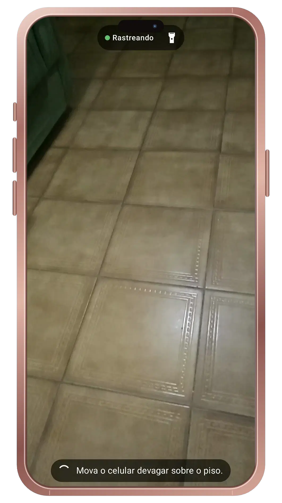

  <picture>
    <source media="(prefers-color-scheme: dark)" srcset="assets/readme/roverquest-rover-and-flag.png">
    <source media="(prefers-color-scheme: light)" srcset="assets/readme/roverquest-app-icon-ligth.png">
    
  </picture>

<h1 align="center">RoverQuest</h1>

  
  
  
  
   
   

  
  
  
   
  
  
  

  Jogo de realidade mista para Android em que você guia um pequeno rover virtual pela sua casa: ele enxerga os objetos reais ao redor e encontra sozinho o caminho para desviar deles.

## O jogo

Sua casa vira a fase. Caixas, livros e almofadas de verdade se tornam obstáculos para um pequeno rover virtual que enxerga o ambiente e encontra o próprio caminho.

| Modo | Como jogar | O que tem de especial |
| --- | --- | --- |
| 🧱 **Monte o labirinto** | Espalhe objetos reais para deixar o caminho do rover o mais longo possível, sem bloqueá-lo totalmente. Quanto maior a rota, mais pontos. | Você é o criador da fase, e cada partida é diferente. |
| 🔋 **Coleta** | Baterias e cristais aparecem pelo chão. Escolha a ordem de coleta e vença o relógio. | Estratégia rápida: o rover obedece, você decide. |
| 👀 **Esconde-esconde** | Itens ficam escondidos atrás dos seus móveis e só aparecem quando você dá a volta neles. | Os objetos virtuais se escondem atrás dos reais, como se estivessem mesmo ali. |

**O rover tem personalidade:** fica curioso ao explorar, se assusta com obstáculos e comemora quando chega.

> 🚧 Em desenvolvimento: os modos acima são a proposta do jogo e ainda não estão implementados.

## Versão beta

  

> **Já funciona:** detecção do piso, rover e destino por toque, rota com A* e desvio de obstáculo virtual.  
> **Em desenvolvimento:** obstáculos reais pela câmera, movimento do rover e modos de jogo.

## Requisitos

| Item | Requisito |
| --- | --- |
| Android | 7.0 ou superior |
| ARCore | Obrigatório: o modelo precisa estar na [lista de dispositivos compatíveis](https://developers.google.com/ar/devices) |
| App | [Google Play Services for AR](https://play.google.com/store/apps/details?id=com.google.ar.core) instalado |

Testado no Galaxy S23 Ultra. Para instalar, baixe o APK em [Releases](https://github.com/lianeheidemann/rover-quest-mr/releases/latest) e permita a instalação de fontes desconhecidas.

## Onde jogar

> [!IMPORTANT]
> O rover enxerga o ambiente pela câmera do celular. Escolha bem o lugar para ele não se confundir.

| ✅ Prefira | ❌ Evite |
| --- | --- |
| Ambiente bem iluminado, de dia ou com luz acesa | Penumbra, contraluz ou sol forte direto na câmera |
| Piso com alguma textura (madeira, tapete, piso estampado) | Piso liso de cor única, brilhante ou espelhado |
| Área livre de uns 2 × 2 m, com espaço para você andar ao redor | Corredores apertados ou cantos onde não dá para circular |
| Obstáculos grandes e opacos: caixas, livros empilhados, almofadas | Vidro, espelhos, objetos finos (pés de cadeira, cabos) ou muito pequenos |
| Cena parada enquanto joga | Pessoas e animais passando na frente da câmera |

**Dicas:** antes de posicionar o rover, mova o celular devagar apontando para o piso até aparecerem os pontos brancos; mantenha o celular a cerca de 0,5–3 m dos obstáculos; se aparecer o aviso de rastreamento perdido, volte a apontar para o piso, devagar.

## Licença

Distribuído sob a [licença MIT](LICENSE). Os ícones da interface vêm do Material Design (Apache 2.0).
