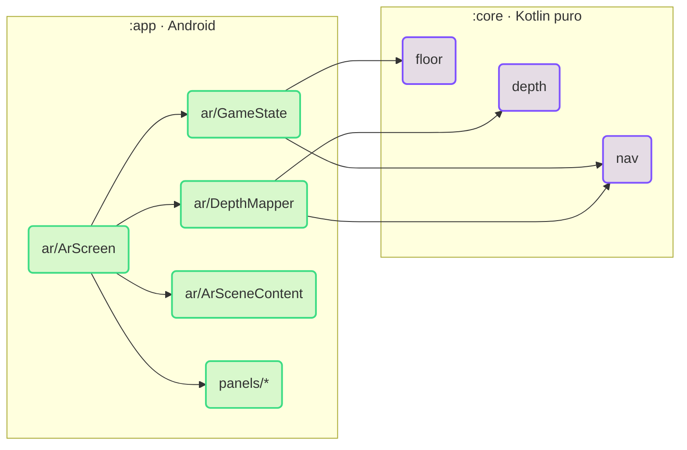

# RoverQuest — código do jogo

Projeto Android em Kotlin com dois módulos Gradle. Visão geral do jogo no [README principal](../README.md);
plano e status em [docs/step-by-step.md](../docs/step-by-step.md).

| Módulo | Conteúdo |
| --- | --- |
| `:app` | Aplicativo Android: sessão AR (ARCore + SceneView), cena 3D e interface em Jetpack Compose |
| `:core` | Regras do jogo em Kotlin puro, sem Android, com testes JUnit |

A dependência é em um sentido só: `:app` usa `:core`. Versões fixas em [`gradle/libs.versions.toml`](gradle/libs.versions.toml).

## Requisitos

- JDK 17+
- Android SDK com a plataforma de `compileSdk` (`app/build.gradle.kts`), via `ANDROID_HOME` ou `local.properties`
- Celular com ARCore (testado no Galaxy S23 Ultra); o emulador não é suportado

## Comandos

Dentro de `game/`:

```bash
./gradlew :core:test                # testes da lógica
./gradlew :app:compileDebugKotlin   # confere se o app compila
./gradlew :app:assembleDebug        # gera app/build/outputs/apk/debug/app-debug.apk
./gradlew :app:installDebug         # instala no celular via adb
adb logcat -s RoverQuest            # logs do app
```

APKs prontos ficam em [Releases](https://github.com/lianeheidemann/rover-quest-mr/releases): um a cada merge na
`main` e um [APK de teste da `develop`](https://github.com/lianeheidemann/rover-quest-mr/releases/download/test-develop/RoverQuest-develop.apk)
(**Actions → APK de teste → Run workflow**, para qualquer branch).

## Arquitetura



### `:app` — `io.github.lianeheidemann.roverquest.ui`

| Arquivo | Responsabilidade |
| --- | --- |
| `RoverQuestApp.kt` | Permissão da câmera, checagem do ARCore e escolha da tela |
| `ar/ArScreen.kt` | Tela do jogo: liga sessão AR, estado, cena e painéis |
| `ar/GameState.kt` | Estado da partida e ações do jogador, repassadas ao `:core` |
| `ar/DepthMapper.kt` | Profundidade do ARCore a 10 Hz → mapa de obstáculos e diagnóstico |
| `ar/SessionRecordings.kt` | Grava e repete sessões do ARCore |
| `ar/FrameLoop.kt` | Loop por quadro do rover, da saudação e da dança |
| `ar/ArSceneContent.kt`, `ar/MapOverlay.kt` | Nós 3D (rover, bandeira, obstáculo, rota, retículo) e grade do mapa |
| `panels/` | Barra de status, painel de instruções e diagnóstico de profundidade |
| `components/`, `Labels.kt` | Botões reutilizados e textos da interface |

### `:core` — `io.github.lianeheidemann.roverquest.core`

| Pacote | Responsabilidade |
| --- | --- |
| `startup` | O que mostrar antes da AR e nível de suporte à profundidade |
| `floor` | Rover, destino e obstáculo no piso, validações e avisos (`FloorSetup`, `setupHint`) |
| `depth` | Leitura de profundidade, projeção para o piso e estimativa do chão (`FloorLevel`) |
| `nav` | Grade de 5 cm, mapa de obstáculos com histerese, A*, planejamento, movimento e animações do rover |

### Princípios

- Posições do jogo são relativas à **âncora do piso**, criada onde o rover é colocado.
- Regras ficam no `:core`; a interface só mostra estado e envia ações.
- Profundidade: `DepthMapper` → `projectToFloor` → `FloorLevel` → `ObstacleMap` → `planRoute`.
- Sem profundidade, o jogo avisa e só o obstáculo manual bloqueia.

## Modelos 3D

Em `app/src/main/assets/models/`. O jogo usa versões otimizadas dos originais gerados por IA
(`rover-mini.glb`, `destination-flag.glb`), feitas fora do build:

```bash
npx gltfpack@1.3.0 -i rover-mini.glb -o rover-mini-lite.glb -si 0.05 -cc -noq
npx gltfpack@1.3.0 -i destination-flag.glb -o destination-flag-lite.glb -si 0.06 -cc -noq
```

Depois, texturas reduzidas de 4096 para 1024 px. `-noq` mantém as posições em float, que o SceneView
precisa para calcular a escala do modelo.
