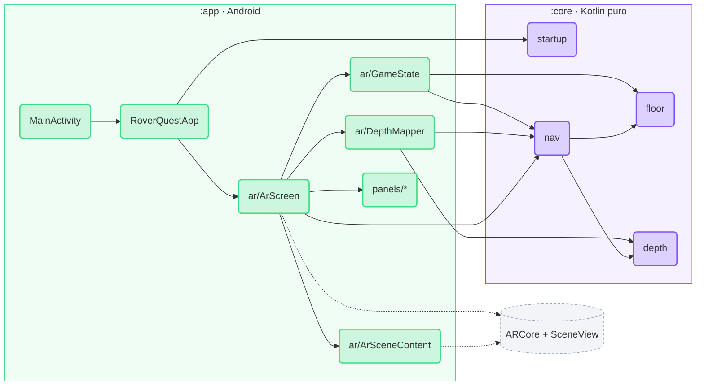
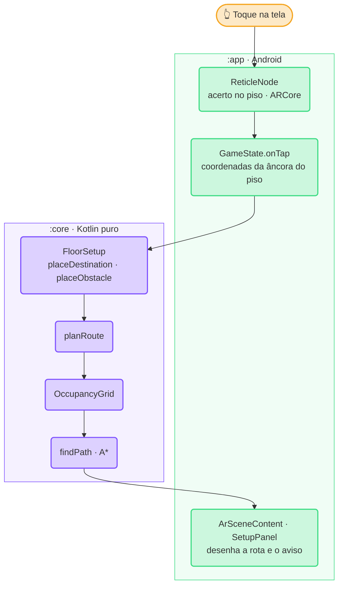
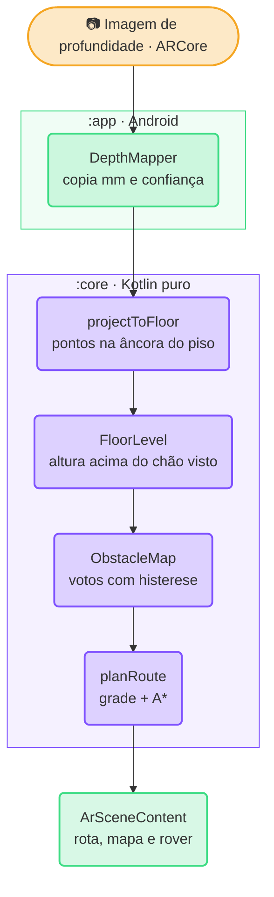

# RoverQuest — código do jogo

Projeto Android (Kotlin + Gradle) do RoverQuest. Visão geral do jogo no [README principal](../README.md).

## Requisitos

- JDK 17 ou superior
- Android SDK com a plataforma definida em `compileSdk` (`app/build.gradle.kts`), com `ANDROID_HOME` configurado ou `local.properties` apontando para o SDK. Sem Android Studio, dá para instalar só o necessário com o [command-line tools](https://developer.android.com/tools/sdkmanager): `sdkmanager "platforms;android-37.2" "build-tools;37.0.0" "platform-tools"`
- Celular Android compatível com ARCore (testado no Galaxy S23 Ultra); o emulador não é suportado

## Estrutura

```
game/
├── settings.gradle.kts        inclui :app e :core
├── gradle/libs.versions.toml  versões fixas de todas as dependências
├── app/   (:app)  Android — câmera, AR, interface
│   └── src/main/
│       ├── kotlin/.../roverquest/
│       │   ├── MainActivity.kt
│       │   └── ui/
│       │       ├── RoverQuestApp.kt, Labels.kt
│       │       ├── ar/          tela AR: estado da partida, profundidade, gravação, cena 3D
│       │       ├── panels/      barra de status, painel de instruções, diagnóstico
│       │       └── components/  botões reutilizados
│       ├── assets/models/       modelos 3D (.glb)
│       └── res/                 ícones, tema, textos
└── core/  (:core) Kotlin puro — regras do jogo + testes JUnit
    └── src/
        ├── main/kotlin/.../core/  startup/, floor/, depth/, nav/
        └── test/kotlin/.../core/  testes por pacote
```

| Módulo | Conteúdo |
| --- | --- |
| `app/` | Aplicativo Android: sessão AR (ARCore + SceneView), interface em Jetpack Compose |
| `core/` | Lógica do jogo em Kotlin puro, sem dependências Android, com testes JUnit |

As versões das dependências ficam em [`gradle/libs.versions.toml`](gradle/libs.versions.toml).

A dependência é em um sentido só: `:app` usa `:core`; `:core` nunca conhece Android nem ARCore.



## Arquitetura

### `:core` — regras do jogo

Pacote `io.github.lianeheidemann.roverquest.core`, organizado por domínio:

| Pacote | Arquivo | Responsabilidade |
| --- | --- | --- |
| `startup` | `StartupState.kt` | Decide o que mostrar antes da AR (verificando, AR não suportada, câmera negada, falha da sessão, pronto) |
| | `DepthSupport.kt` | Classifica o suporte à profundidade (nenhum, automática, automática + Raw Depth) |
| `floor` | `FloorSetup.kt` | Estado no piso: área confirmada, rover, destino e obstáculo manual, com validações (mesmo piso, distância, sobreposição), o aviso ao jogador (`setupHint`) e a direção do rover (`headingDegrees`) |
| `depth` | `DepthFrame.kt` | Imagem de profundidade (mm) e confiança, já copiadas do ARCore |
| | `DepthReport.kt` | Diagnóstico da leitura: distância no centro, confiança, cobertura e motivo da incerteza |
| | `DepthColors.kt` | Pinta a profundidade (vermelho perto, azul longe) para a sobreposição de diagnóstico |
| | `DepthProjection.kt` | Converte pixels de profundidade em pontos no frame da âncora do piso (`projectToFloor`) |
| | `FloorLevel.kt` | Ajusta um plano ao chão visto e mede as alturas a partir dele, não da âncora |
| `nav` | `OccupancyGrid.kt` | Grade de células de 5 cm em 5 × 5 m centrada no rover: livre, ocupada ou desconhecida |
| | `ObstacleMap.kt` | Mapa de obstáculos da profundidade: votos por célula (obstáculo 5–40 cm, chão ±3 cm) com histerese |
| | `AStar.kt` | A* com 8 vizinhos, sem cortar quinas, com o motivo quando não há rota |
| | `RoutePlanner.kt` | Monta a grade (mapa + folga do rover + obstáculo manual), roda o A*, leva o destino colado em móvel ao chão livre mais próximo e gera os pontos para desenhar |
| | `GridColors.kt` | Cores de cada célula para a sobreposição do mapa |
| | `RoverMotion.kt` | Movimento do rover pela rota: gira, anda, pausa sem rastreamento, replaneja e para a 22 cm da bandeira |
| | `RoverGreeting.kt` | Saudação ao colocar o rover: meia-volta, vem até o jogador, cumprimenta e volta |
| | `RoverDance.kt` | Dancinha de vitória: vira para o jogador, balança, gira e dá dois pulinhos |

Estilo funcional: recebe dados prontos (coordenadas, estados) e devolve objetos imutáveis
(`FloorSetup`, `RoutePlan`, `RoverMotion`). Animações são funções do tempo. Tudo é testável sem câmera, com os testes em `core/src/test/`.

### `:app` — Android

| Arquivo | Responsabilidade |
| --- | --- |
| `MainActivity.kt` | Ponto de entrada; só abre a interface |
| `ui/RoverQuestApp.kt` | Pede a permissão da câmera, verifica o ARCore e escolhe a tela via `resolveStartupState` (`:core`) |
| `ui/Labels.kt` | Textos mostrados ao jogador (rastreamento, profundidade, dicas e recusas) |
| `ui/ar/ArScreen.kt` | Tela do jogo: liga a sessão AR (SceneView), os estados abaixo, a cena 3D e os painéis |
| `ui/ar/GameState.kt` | Estado da partida (setup, rover, saudação, dança, âncora) e ações do jogador (tocar, Ir, Parar, Recomeçar), repassadas ao `:core` |
| `ui/ar/DepthMapper.kt` | Lê a profundidade do ARCore a 10 Hz e alimenta `FloorLevel` → `ObstacleMap` e o diagnóstico |
| `ui/ar/SessionRecordings.kt` | Grava e repete a sessão do ARCore (MP4 em pasta privada do app) |
| `ui/ar/FrameLoop.kt` | `RunEachFrame`: loop por quadro que move o rover e toca a saudação e a dança |
| `ui/ar/ArSceneContent.kt` | Nós 3D presos à âncora: rover, bandeira, obstáculo virtual, pontos da rota e retículo |
| `ui/ar/MapOverlay.kt` | Desenha a grade do mapa de obstáculos sobre o piso |
| `ui/panels/StatusBar.kt` | Barra do topo: rastreamento, profundidade, mapa, lanterna e ⋮ Resetar jogo |
| `ui/panels/SetupPanel.kt` | Painel de baixo: dica, Ir/Parar, Destino/Obstáculo, ✕, ↻ e confirmar área |
| `ui/panels/DepthDiagnostics.kt` | Sobreposição colorida da profundidade e painel de diagnóstico (gravar/repetir) |
| `ui/components/Controls.kt` | Botões reutilizados: `IconToggle` e `CompactChip` |
| `assets/models/` | Modelos 3D. O rover usa `rover-mini-lite.glb` (58 mil vértices, texturas de 1024 px), gerado a partir de `rover-mini.glb`; `rover.glb` e `rover-mini.glb` são os originais, guardados para a futura troca de rover. A bandeira de chegada usa `destination-flag-lite.glb` (68 mil vértices, texturas de 1024 px), gerado a partir do original `destination-flag.glb` |
| `res/` | Ícones (Material, Apache 2.0), tema escuro, tela de abertura e textos |

### Fluxo de um toque



### Princípios

- Posições do jogo são relativas à **âncora do piso**, criada onde o rover é colocado; por isso tudo fica preso ao chão quando o celular se move.
- A interface só exibe estado e envia ações; regras ficam no `:core`.
- Profundidade: o `:app` só copia a imagem do ARCore; projeção, nivelamento do chão e mapa ficam no `:core` (Partes 4 e 5 do [plano](../docs/step-by-step.md)).
- Se a profundidade não existir, o jogo avisa e só o obstáculo manual bloqueia.

### Fluxo da profundidade



### Modelos 3D otimizados

Modelos gerados por IA costumam ser pesados demais para rodar junto com a câmera e a profundidade.
O `rover-mini-lite.glb` e o `destination-flag-lite.glb` foram gerados assim (fora do projeto, sem
dependência no build):

```bash
npx gltfpack@1.3.0 -i rover-mini.glb -o rover-mini-lite.glb -si 0.05 -cc -noq
npx gltfpack@1.3.0 -i destination-flag.glb -o destination-flag-lite.glb -si 0.06 -cc -noq
```

Depois, as texturas foram reduzidas de 4096 para 1024 px. `-noq` mantém as posições em float: com
posições quantizadas, o SceneView calcula a escala do modelo de forma errada.

## Comandos

Execute dentro desta pasta:

```bash
./gradlew :core:test                # testes da lógica
./gradlew :app:compileDebugKotlin   # só confere se o app compila (rápido)
./gradlew :app:assembleDebug        # gera o APK de debug
./gradlew :app:installDebug         # instala no celular conectado via adb
adb logcat -s RoverQuest            # logs do app
```

O APK gerado fica em `app/build/outputs/apk/debug/app-debug.apk`.

APKs prontos para instalar ficam em [Releases](https://github.com/lianeheidemann/rover-quest-mr/releases), publicados pela CI a cada merge na `main`.

Para testar outra branch (ex.: `develop`) sem merge: **Actions → APK de teste → Run workflow**, escolha a branch. O APK aparece em Releases como `<branch> (teste)`, substituído a cada build.

APK de teste mais recente da `develop` (link fixo): [RoverQuest-develop.apk](https://github.com/lianeheidemann/rover-quest-mr/releases/download/test-develop/RoverQuest-develop.apk). Para outra branch, troque `develop` pelo nome dela (com `/` trocado por `-`) nas duas partes do link.
