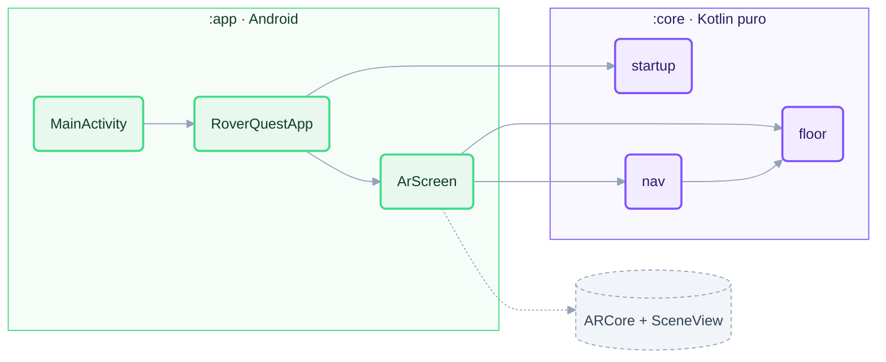
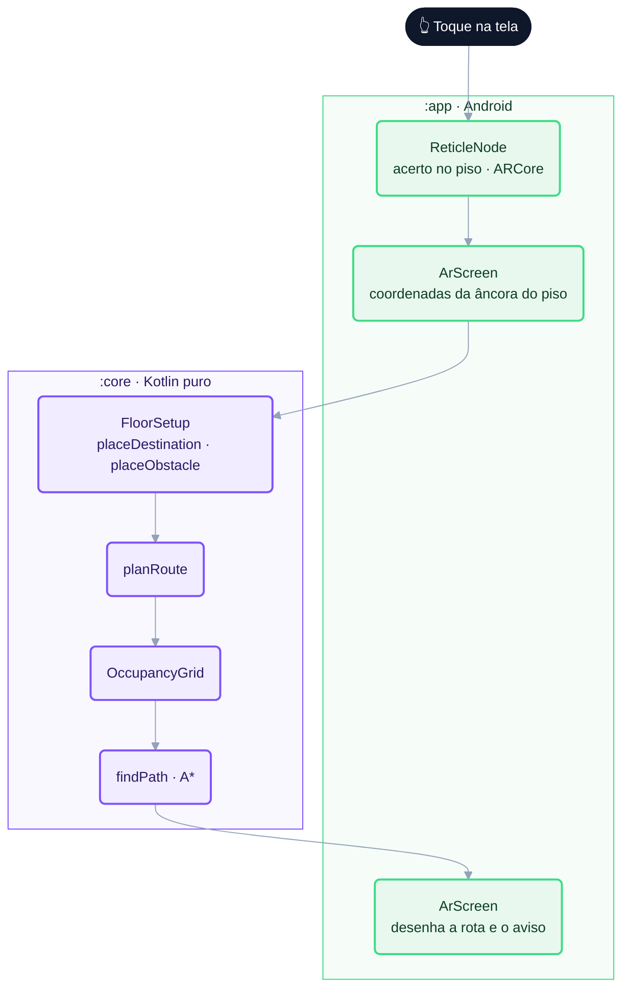

# RoverQuest MR — código do jogo

Projeto Android (Kotlin + Gradle) do RoverQuest MR. Visão geral do jogo no [README principal](../README.md).

## Requisitos

- JDK 17 ou superior
- Android SDK com a plataforma definida em `compileSdk` (`app/build.gradle.kts`), com `ANDROID_HOME` configurado ou `local.properties` apontando para o SDK
- Celular Android compatível com ARCore (testado no Galaxy S23 Ultra); o emulador não é suportado

## Estrutura

```
game/
├── settings.gradle.kts        inclui :app e :core
├── gradle/libs.versions.toml  versões fixas de todas as dependências
├── app/   (:app)  Android — câmera, AR, interface
└── core/  (:core) Kotlin puro — regras do jogo + testes JUnit
```

| Módulo | Conteúdo |
| --- | --- |
| `app/` | Aplicativo Android: sessão AR (ARCore + SceneView), interface em Jetpack Compose |
| `core/` | Lógica do jogo em Kotlin puro, sem dependências Android, com testes JUnit |

As versões das dependências ficam em [`gradle/libs.versions.toml`](gradle/libs.versions.toml).

A dependência é em um sentido só: `:app` usa `:core`; `:core` nunca conhece Android nem ARCore.



## Arquitetura

### `:core` — regras do jogo

Pacote `io.github.lianeheidemann.roverquest.core`, organizado por domínio:

| Pacote | Arquivo | Responsabilidade |
| --- | --- | --- |
| `startup` | `StartupState.kt` | Decide o que mostrar antes da AR (verificando, AR não suportada, câmera negada, falha da sessão, pronto) |
| | `DepthSupport.kt` | Classifica o suporte à profundidade (nenhum, automática, automática + Raw Depth) |
| `floor` | `FloorSetup.kt` | Estado no piso: rover, destino e obstáculo manual, com validações (mesmo piso, distância, sobreposição) e o aviso ao jogador (`setupHint`) |
| `nav` | `OccupancyGrid.kt` | Grade de células de 5 cm em 5 × 5 m centrada no rover: livre, ocupada ou desconhecida |
| | `AStar.kt` | A* com 8 vizinhos, sem cortar quinas, com o motivo quando não há rota |
| | `RoutePlanner.kt` | Monta a grade a partir do `FloorSetup`, roda o A*, simplifica a rota e gera os pontos para desenhar |

Estilo funcional: recebe dados prontos (coordenadas, estados) e devolve objetos imutáveis
(`FloorSetup`, `RoutePlan`). Tudo é testável sem câmera, com os testes em `core/src/test/`.

### `:app` — Android

| Arquivo | Responsabilidade |
| --- | --- |
| `MainActivity.kt` | Ponto de entrada; só abre a interface |
| `ui/RoverQuestApp.kt` | Pede a permissão da câmera, verifica o ARCore e escolhe a tela via `resolveStartupState` (`:core`) |
| `ui/ArScreen.kt` | Sessão AR (SceneView): converte o toque no piso para coordenadas da âncora, chama o `FloorSetup` e desenha rover, destino, obstáculo e rota como filhos da âncora; painéis de status e instruções |
| `assets/models/` | Modelos 3D do rover (`rover.glb`, `rover-mini.glb`), ainda não usados no código |
| `res/` | Ícone e textos |

### Fluxo de um toque



### Princípios

- Posições do jogo são relativas à **âncora do piso**, criada onde o rover é colocado; por isso tudo fica preso ao chão quando o celular se move.
- A interface só exibe estado e envia ações; regras ficam no `:core`.
- Profundidade: a leitura entra no `:app` (Parte 4) e a conversão em células da grade no `:core` (Parte 5), conforme o [plano](../docs/step-by-step.md).

## Comandos

Execute dentro desta pasta:

```bash
./gradlew :core:test           # testes da lógica
./gradlew :app:assembleDebug   # gera o APK de debug
./gradlew :app:installDebug    # instala no celular conectado via adb
adb logcat -s RoverQuest       # logs do app
```

O APK gerado fica em `app/build/outputs/apk/debug/app-debug.apk`.

APKs prontos para instalar ficam em [Releases](https://github.com/lianeheidemann/rover-quest-mr/releases), publicados pela CI a cada merge na `main`.

Para testar outra branch (ex.: `develop`) sem merge: **Actions → APK de teste → Run workflow**, escolha a branch. O APK aparece em Releases como `<branch> (teste)`, substituído a cada build.
